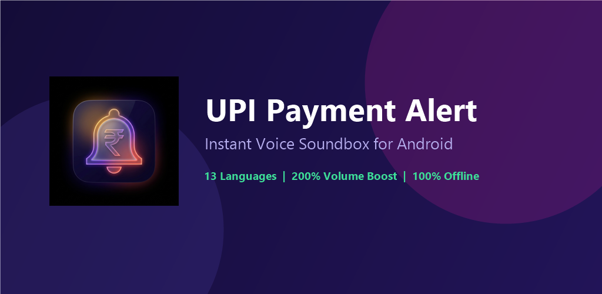

<div align="center">



# UPI Payment Alert

**Offline UPI voice soundbox for Android. Zero hardware rentals, zero cloud servers, zero data collection.**

[](https://github.com/official-Arvind/UPIPaymentAlert/releases/latest)
[](LICENSE)
[-6366f1?style=flat-square)](https://official-arvind.github.io/UPIPaymentAlert/privacy.html)
[](https://official-arvind.github.io/UPIPaymentAlert/)

[**Visit Official Website**](https://official-arvind.github.io/UPIPaymentAlert/) &nbsp;·&nbsp; [**Download Release APK**](https://github.com/official-Arvind/UPIPaymentAlert/releases/latest) &nbsp;·&nbsp; [**3-Month Free Complete Offer**](https://official-arvind.github.io/UPIPaymentAlert/download.html)

</div>

---

> **Limited-Time Launch Offer (Free for 3 Months):**  
> Download **UPI Payment Alert Complete Edition (v1.0.2)** — featuring Jetpack Compose Material 3 UI, live Credit/Debit donut & trend charts, Review queue, and Home-Screen widgets — **free until 28 Feb 2027** exclusively from [**official-arvind.github.io/UPIPaymentAlert**](https://official-arvind.github.io/UPIPaymentAlert/download.html).

---

## Built for Real Counters, Priced at Zero

Hardware soundboxes lock merchants into single-provider contracts and ₹125–₹200 monthly rentals. UPI Payment Alert turns any spare or daily Android device (Android 7.0–15) into an instant multi-app voice register with full privacy.

- **100% On-Device. Zero Data Collection.**  
  No analytics SDKs, no ad trackers, no cloud storage, and no accounts. SMS parsing, notification filtering, TTS speech generation, and Room ledger persistence stay strictly on your phone.
- **Dual SMS & Notification Capture**  
  Reads payment alerts from PhonePe, Google Pay, Paytm, BHIM, Amazon Pay, Cred, FamPay, and 25+ bank apps with a 60-second sliding deduplication window.
- **13 Indian Languages**  
  English, Hindi, Gujarati, Marathi, Tamil, Telugu, Kannada, Malayalam, Punjabi, Bengali, Odia, Assamese, and Urdu — with per-language UI switching and Indian voice binding.
- **+1500 mB Hardware Loudness Boost**  
  Uses `android.media.audiofx.LoudnessEnhancer` directly on the TTS audio session so announcements stay audible in crowded shops.
- **Segmented Amount Speed**  
  Controls currency reading rate (`0.5x`–`1.5x`) independently of surrounding phrases (`0.9x`).
- **Carrier SMS Forwarder**  
  Forwards parsed payment alerts directly over standard SIM SMS to partner or staff numbers.

---

## Screen Showcase (Privacy-Blurred Real Captures)

<div align="center">
<table>
  <tr>
    <td align="center"><br/><sub><b>Home (Masked Mode)</b></sub></td>
    <td align="center"><br/><sub><b>Revenue Chart</b></sub></td>
    <td align="center"><br/><sub><b>Credit &amp; Debit Donut</b></sub></td>
    <td align="center"><br/><sub><b>Audio Diagnostics</b></sub></td>
  </tr>
</table>
</div>

See every screen — Review queue, Manual Entry, Full Statement History, and Transaction Detail — on [**official-arvind.github.io/UPIPaymentAlert**](https://official-arvind.github.io/UPIPaymentAlert/).

---

## Open-Source Edition vs Complete Edition

| Capability | Open-Source (`v2.0.1`, MIT) | Complete (`v1.0.2` · Free for 3 Months) |
| :--- | :---: | :---: |
| **Voice Engine & 13 Indian Languages** | Included | Included |
| **+1500 mB Loudness Boost** | Included | Included |
| **Dual SMS & Notification Capture** | Included | Included |
| **Carrier SMS Forwarder** | Included (1 target) | Multi-number (+91 / +977 auto-detect, 10/min cap) |
| **Architecture** | Native Java + XML Views | Kotlin + Jetpack Compose Material 3 |
| **Balance Privacy & Monthly Reset** | — | Masked launch (`••••`), monthly 1st auto-reset |
| **Analytics & Charts** | Summary list & HTML export | Interactive Bézier chart + 2D/3D Credit/Debit donut |
| **Review Inbox & Searchable Ledger** | — | Ambiguous-alert Review queue + filters |
| **Home-Screen Widgets** | — | 2×2 & 4×2 live counter widgets |
| **Cloud Sync / Telemetry** | Zero (100% Offline) | Zero external tracking |

---

## Languages Supported

| Language | Code | Native Script | Spoken Sample |
| :--- | :---: | :--- | :--- |
| English | `en` | English | *500 rupees received* |
| Hindi | `hi` | हिन्दी | *500 रुपये प्राप्त हुए* |
| Gujarati | `gu` | ગુજરાતી | *500 રૂપિયા મળ્યા* |
| Marathi | `mr` | मराठी | *500 रुपये मिळाले* |
| Tamil | `ta` | தமிழ் | *500 ரூபாய் பெறப்பட்டது* |
| Telugu | `te` | తెలుగు | *500 రూపాయలు అందాయి* |
| Kannada | `kn` | ಕನ್ನಡ | *500 ರೂಪಾಯಿಗಳು ಸ್ವೀಕರಿಸಲಾಗಿದೆ* |
| Malayalam | `ml` | മലയാളം | *500 രൂപ ലഭിച്ചു* |
| Punjabi | `pa` | ਪੰਜਾਬੀ | *500 ਰੁਪਏ ਪ੍ਰਾਪਤ ਹੋਏ* |
| Bengali | `bn` | বাংলা | *500 টাকা পাওয়া গেছে* |
| Odia | `or` | ଓଡ଼ିଆ | *500 ଟଙ୍କା ଗ୍ରହଣ କରାଗଲା* |
| Assamese | `as` | অসমীয়া | *500 টকা গ্ৰহণ কৰা হ'ল* |
| Urdu | `ur` | اردو | *500 روپے موصول ہوئے* |

---

## Build from Source

Prerequisites: JDK 17, Android SDK 34, Gradle 8+.

```bash
git clone https://github.com/official-Arvind/UPIPaymentAlert.git
cd UPIPaymentAlert

# Unit tests & debug APK
./gradlew testDebugUnitTest assembleDebug

# Unsigned release APK
./gradlew assembleRelease
```

---

## License

MIT License — Copyright (c) 2026 Arvind Ji. See [`LICENSE`](LICENSE).
